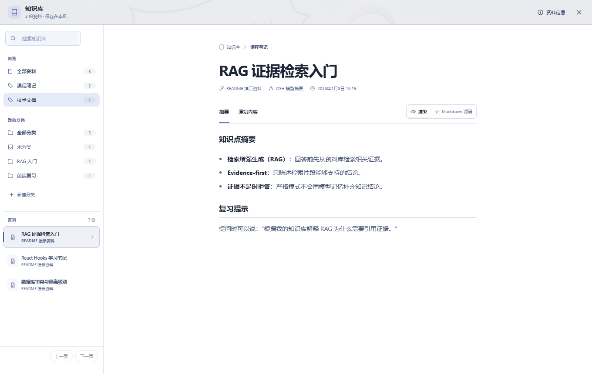

# dsh-wechat-kb · 微信知识库问答

**一个 DSH 插件，把「微信桥接」和「本地知识库」放进同一个设置页。** 在 DSH 里收发微信消息；把 Word / Excel / PDF / 图片 / 音频导入本地知识库，提问时带检索证据回答。

| 项目 | 状态 |
| --- | --- |
| 源码版本 | 1.0.4 |
| 许可 | MIT |
| 宿主 | DSH（cordis bundle，条目 id `dsh-wechat-kb`） |
| 来源 | 由两个上游插件合并，功能实现基本沿用 |



## 能做什么

- **微信 ↔ DSH**：读本机微信数据库收消息，UI 自动化把回复真发回去；可把每个聊天绑到独立会话，设主人、入站白名单与屏蔽名单。
- **本地知识库**：导入 Word / Excel / PDF / 图片 / 音频；PDF 自动抽图并 OCR、音频转写、关键词检索、复习提示词；全程本地 JSON 文件，不要数据库、向量模型或额外 Key。
- **一个设置页**：上半「微信」、下半「知识复习」；左侧栏「微信知识库问答」一键打开这一页，知识库覆盖视图的入口在页面右上角。
- **回答有据可查**：微信来问时先检索本地证据再作答；「严格 / 参考」两种回答策略可在设置里切换，严格策略只陈述资料支持的结论、不输出文件名与引用。

## 安装

```bash
# 推荐：从 git 安装（源码 1.0.4）
dsh plugin install git+https://github.com/YeYirp/dsh-wechat-kb.git

# 或在仓库根目录重新打包后安装
npm pack
dsh plugin install ./dsh-wechat-kb-1.0.4.tgz
```

未发布到 npm registry。插件市场用「自定义目录」加入：在「目录 / Catalogs」添加本仓库根目录的 `plugins.json`（或 clone 到本地后的文件路径），刷新后在「发现」里搜「微信知识库问答」。市场目录与 tarball 已同步到 1.0.4。

## 首次使用

1. 打开设置页「微信知识库问答」→「微信」段，填令牌、绑定聊天与会话。
2. 点「装依赖」准备 Python 桥接运行环境：优先下载上游预装运行环境（60 秒无进展放弃），失败回退 venv + pip，pip 默认源失败自动切清华镜像。
3. 检查「总开关」与「试运行」：默认关总开关 + 开试运行，不会真发消息；确认后再开。
4. 到「知识复习」段设置知识库路径（默认 `$DSH_HOME/project-knowledge-review/knowledge.json`）、OCR 凭据引用名与模型，然后导入文件提问。
5. **入站白名单默认为空 = 一条都不转入 DSH**。要放行请填 wxid / 群 id；昵称和群名只是便利匹配，可被伪造，不要当安全边界。

## 已知限制

- 「主人 / 外人只能聊天」在当前版本不区分主人：微信来的一律按知识库回答，且不能调用知识库检索以外的工具。
- 入站默认拒绝只管「转入 DSH」这一步；Python 桥接仍按自身配置记录群聊日记、保存入站图片。
- 源码自测命令：`node --test lib/*.test.js lib/knowledge/*.test.js`。纯 Node 环境有测试因缺少宿主 peer 依赖或沿用上游旧默认值而失败；在 DSH 宿主内更接近真实运行状态。

## 合并做了哪些改动

**接线与界面**（沿用上游功能实现）：

1. 包名与条目 id 统一为 `dsh-wechat-kb`（设置命名空间、profile 条目 id、前端 bundle id 一致）。
2. `lib/host.js` 合并原微信 `apply`（改名 `applyWechat`）与原知识库 `apply`；知识库代码整体移入 `lib/knowledge/`。
3. 微信侧对本地库的交叉引用改指包内 `lib/knowledge/local-store.js`。
4. 前端只保留一个 `window.__ModuleLoader__.load`（id `dsh-wechat-kb`），设置页合成一页，界面与清单里的「通到微信」统一改为「微信知识库问答」。
5. 左侧栏入口改为「微信知识库问答」，点了直接打开设置并落在这一页；原「知识库」按钮移到该页右上角，点它打开知识库覆盖视图。

**行为调整**（本仓库，不是上游行为）：

6. 知识库数据默认落在 `$DSH_HOME/project-knowledge-review/knowledge.json`（不再是用户主目录下的 `~/.dsh`）。
7. OCR 默认开启：本机网关 `http://127.0.0.1:8326/v1` + `deepseek-official/deepseek-flash`；凭据引用名 `DSH_KNOWLEDGE_OCR_API_KEY`（在 DSH 凭据里配置，不是直接读系统环境变量），三项均可在设置里改。
8. 图片 OCR 过滤放宽：只跳过又小又矮的装饰图；OCR 拒识话术不再写入正文。
9. PDF 抽图 OCR 改为 4 路并发 + 同图去重；对「只返回推理过程」的空输出重试一次（网络超时 / HTTP 错误不重试）。
10. 「装依赖」优先下载上游预装运行环境，失败回退 venv + pip 并自动切清华镜像。
11. 默认屏蔽「文件传输助手」等 7 个会话（仅对新配置生效，老配置不会自动追加）。
12. 入站白名单为空时一条都不转入 DSH；显式绑定过的聊天与主人视同已同意。桥接补装 `zstandard`，微信的压缩文本消息不再被读成半截。

## 仓库

<https://github.com/YeYirp/dsh-wechat-kb>

## 来源与致谢

| 来源插件 | 版本 | 作者 / 仓库 | 本包保留的内容 |
| --- | --- | --- | --- |
| `dsh-wechat-bridge` | 1.4.0 | Yuuyuko-uu / [thawline/dsh-wechat-bridge](https://github.com/thawline/dsh-wechat-bridge) | 微信本地库收消息、UI 自动化发消息、`/dsh-wechat-bridge/*` 路由、`wechat_send` / `wechat_status` 工具、Python 桥接与运行环境管理、「微信」设置段 |
| `dsh-project-knowledge-review` | 0.5.14 | 原作者（见 `docs/project-knowledge-review-README.md`） | 本地知识库：导入、图片 OCR、音频转写、检索、复习提示词；`project_knowledge_*` 七个工具；`/api/project-knowledge-review/*` 路由；「知识复习」设置段 |

两边 README 原文在 `docs/wechat-bridge-README.md` 和 `docs/project-knowledge-review-README.md`，更新日志在 `docs/wechat-bridge-CHANGELOG.md`，截图在 `docs/images/`。上游文档是功能细节最准确的说明书，本 README 只讲合并后哪里不一样。

## MIT

本包及其包含的两个上游组件均按 MIT 许可证发布，完整条款见仓库 `LICENSE`。MIT 允许使用、复制、修改、合并、发布、分发、再许可和销售，条件是保留版权与许可声明；软件按「原样」提供，不作任何担保。

- 微信桥接部分：© Yuuyuko-uu / thawline
- 知识复习部分：© 其原作者（上游 README 标为 MIT）
- 合并包不对上游功能主张著作权
